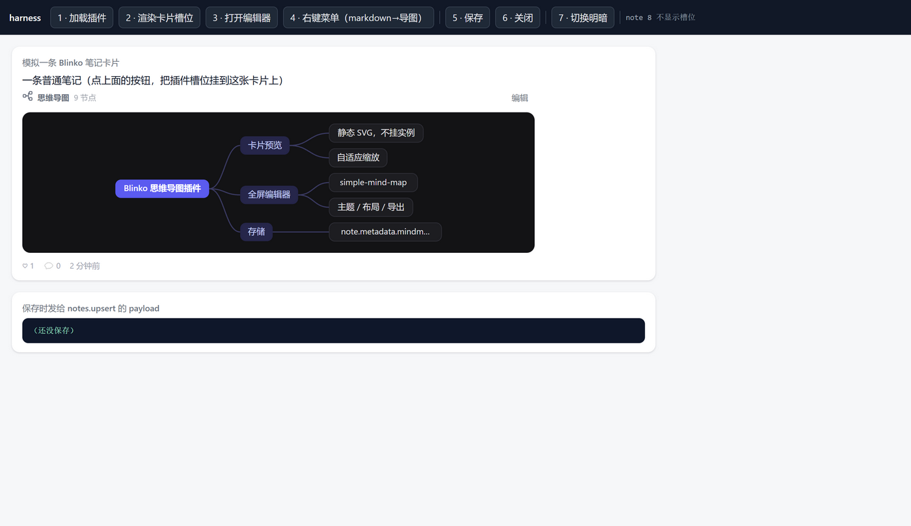
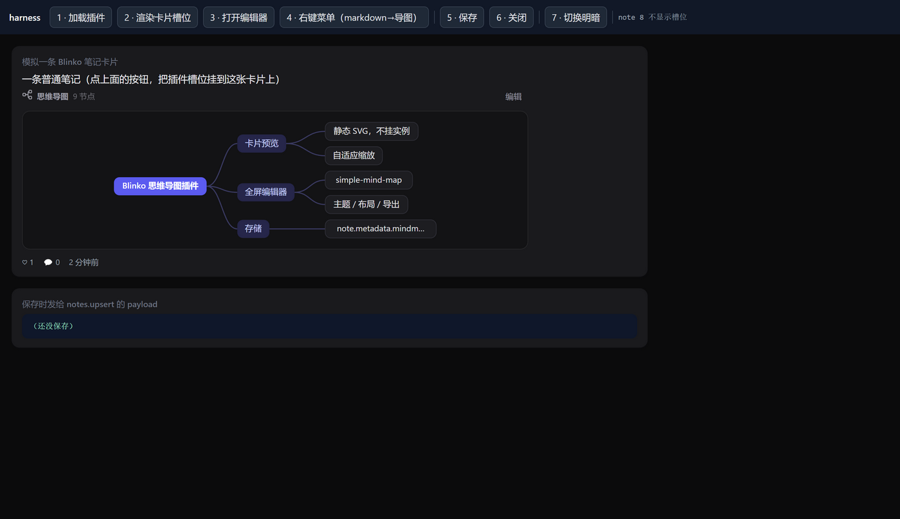
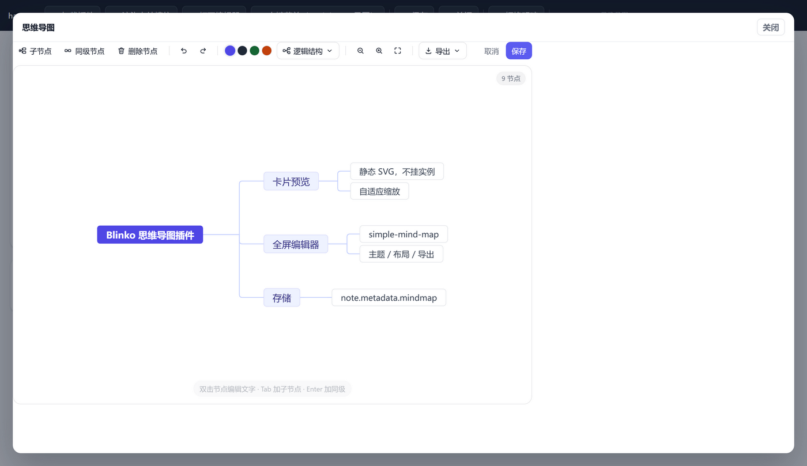
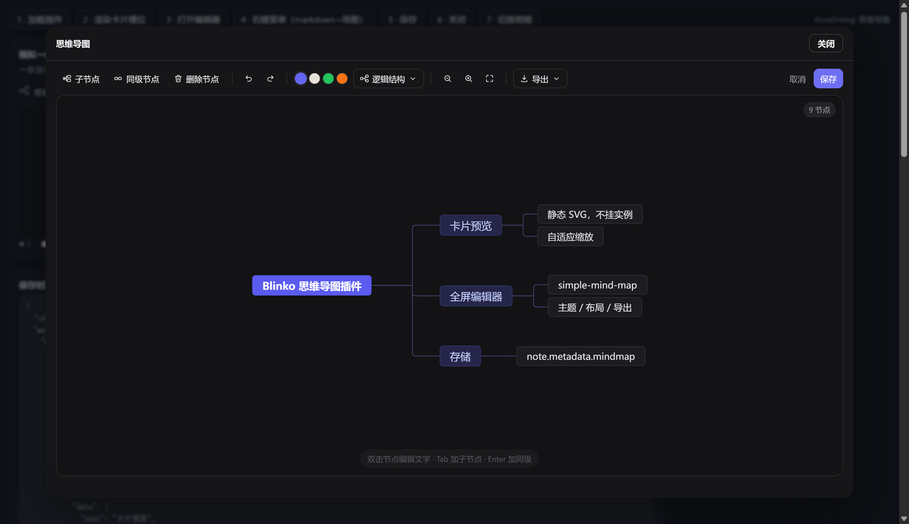

# blinko-mindmap

给 [Blinko](https://github.com/blinkospace/blinko) 加一个思维导图能力：一条笔记顺手变成一张可编辑、可拖拽、可导出的导图，**导图就存在这条笔记里**，跟着备份、分享、搜索一起走。

## 三个入口

| 位置 | 作用 |
| --- | --- |
| 笔记卡片底部 | 有导图的笔记自动多一块 SVG 预览（点一下就是编辑器），没有导图的笔记不出现任何东西 |
| 笔记右键菜单 | 「思维导图」——已有导图直接打开；没有的话，用这条笔记的 markdown 大纲现场生成一张 |
| 编辑器工具栏 | 一个树形图标，新建一条独立的导图笔记 |

## 编辑器里能做什么

- 子节点 / 同级节点 / 删除节点，撤销重做
- **在画布上直接改字**：双击节点、或选中节点后直接打字都能进入编辑；Enter 提交、Shift+Enter 换行、Esc 取消、点空白处也会提交
- 键盘操作：`Tab` 加子节点、`Enter` 加同级、`Delete` 删节点、`F2` 改文字、方向键在节点间移动
- 四套配色（靛蓝 / 纸张 / 森林 / 日落）、八种布局（逻辑结构、向左、思维导图、组织结构、目录、时间轴、竖向时间轴、鱼骨图）
- **跟随 Blinko 的白天 / 黑夜模式**：画布、节点、工具栏、下拉菜单一起变色，切主题时不用重开对话框
- 导出 PNG / JSON / SMM（SMM 可再用桌面客户端打开）
- 保存：写回当前笔记；从工具栏新建时，会顺手建一条 `# 标题` 的笔记装这张图

## 数据存在哪

存在 `note.metadata.mindmap`，不是正文：

```json
{
  "v": 1,
  "engine": "simple-mind-map@0.14.0",
  "updatedAt": "2026-11-19T08:21:24.891Z",
  "layout": "logicalStructure",
  "root": { "data": { "text": "项目规划" }, "children": [ ... ] },
  "theme": { "template": "indigo" },
  "view": { "transform": { ... } }
}
```

为什么不是 markdown 正文：导图 JSON 有几十 KB，塞进正文会让卡片预览、全文搜索、AI 摘要全部变味；`metadata` 是 Blinko 自带的 `z.any()` 字段，随笔记一起导出/备份/分享，并且 `notes.upsert` 对 metadata 是浅合并，只动 `mindmap` 这个键，不会踩掉别的插件的数据。卸载插件后导图数据也不会丢，重新装上就还在。

卡片预览是**一次性生成的静态 SVG**，不是活的导图实例：Blinko 的列表会反复创建销毁卡片，每张卡片挂一个实例会不断泄漏监听器。预览最多画 160 个节点，点击进入编辑器才是完整导图。

## 长什么样

卡片里那块预览（有导图的笔记才有，点一下进编辑器），白天 / 黑夜两版：

| 白天 | 黑夜 |
| --- | --- |
|  |  |

全屏编辑器：

| 白天 | 黑夜 |
| --- | --- |
|  |  |

## 安装
插件中填入 https://github.com/jhk5263/blinko-mindmap
